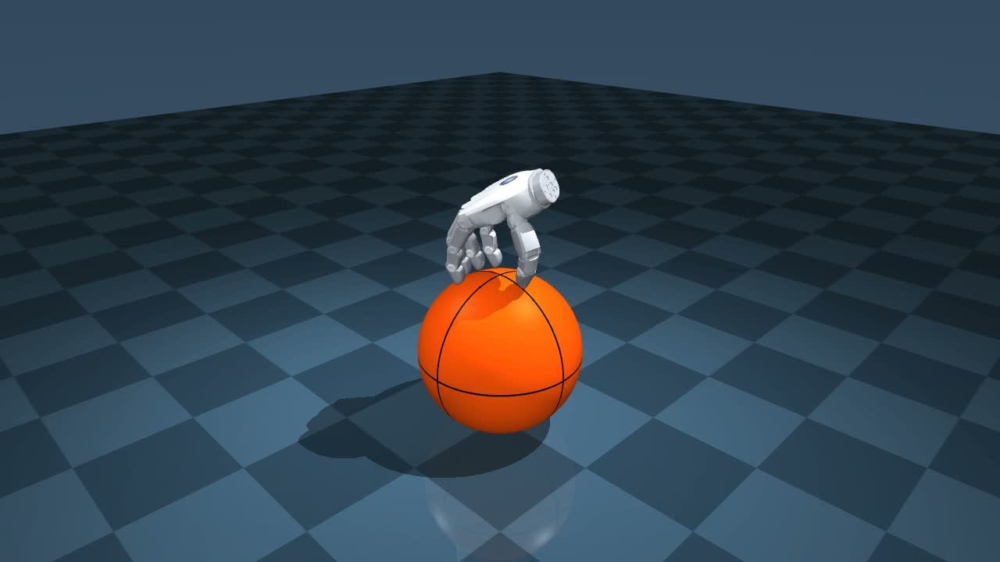

# Revo3 Ball Locomotion

A floating Revo3 right hand balances on a free ball and moves it through finger
contacts. PPO policies track planar velocity commands; training uses MjLab and
MuJoCo Warp, with independent native MuJoCo evaluation.

[Watch the 20-second demo](media/demo.mp4)



The demo uses v178/7750, a 0.15 m/s command amplitude, forward/left/backward
commands, and a 270-degree camera orbit. It omits rightward commands. This is a
visual demonstration at an increased command amplitude, not a 0.15 m/s tracking
benchmark. The policy's training target is 0.1 m/s.

## Released checkpoints

All three checkpoints and their environment/runner configurations are included
in `checkpoints/`. Clone normally; Git LFS is not required. Start with v178/7750
to reproduce the demo. Use v152/7650 when comparing completion rates.

| Run / iteration | Completed trials | Why it is included |
| --- | ---: | --- |
| v178 action bounds / **7750** | **118/120** | Current demo; raw-action excess and body-acceleration penalties |
| v152 settled smooth tracking / **7650** | **120/120** | Strong completion baseline with mixed settled starts |
| v171 body acceleration / **7650** | **117/120** | Comparison policy with explicit body-acceleration cost |

The batch has 10 command profiles × 3 seeds × 2 timesteps × 2 backends.
Each trial lasts 30 seconds, at a requested 0.1 m/s. Native MuJoCo and MjLab /
MuJoCo Warp each test 0.5 ms and 1 ms physics; control runs at 100 Hz.
These are selected checkpoints, not an exhaustive leaderboard. Full reports
and the selection rationale are in [evaluations](evaluations/) and
[the checkpoint manifest](checkpoints/manifest.json).

Completion does not imply accurate tracking or absence of jitter. For v178/7750,
the full-trial signed command-axis velocities in completed cardinal trials
average 0.0707 / 0.0692 / 0.0716 / 0.0592 m/s for forward / backward / left /
right. Rightward tracking and rapid transitions remain weaker. Motion is not
yet qualified as jitter-free, and these policies have not been validated on
hardware. More on the evidence in [evaluation notes](docs/evaluation.md).

## Install and prepare the scene

The supported training setup is Linux with an NVIDIA GPU and Python 3.11.
Install a CUDA-compatible PyTorch build first. The recorded environment used
PyTorch 2.7.0 with CUDA 12.8. Native policy inference uses the CPU; headless video
rendering uses EGL.

```bash
git clone https://github.com/DavidLXu/Revo3-Ball-Locomotion.git
cd Revo3-Ball-Locomotion
python3.11 -m venv .venv
source .venv/bin/activate
pip install torch==2.7.0 torchvision==0.22.0 --index-url https://download.pytorch.org/whl/cu128
pip install -r requirements.txt
python scripts/setup_assets.py
python scripts/check_release.py
```

Setup fetches the upstream Revo3 assets at a pinned commit and composes the
scene using the saved opposed-thumb pose. The 0.12 m radius, 0.62 kg ball is
procedural. The generated scene and downloaded assets stay outside Git.
For an existing asset download, place it at `assets/brainco-description` and
run `python scripts/setup_assets.py --skip-download`; all 141 required source
files are checked against the pinned hashes.
See [third-party notices](THIRD_PARTY_NOTICES.md) for the asset licensing boundary.

## Evaluate and record

```bash
CKPT=checkpoints/teleop_opposed_v178_action_bounds_smooth/model_7750.pt
python scripts/evaluate_teleop.py "$CKPT" \
  --speed 0.1 --seconds 30 --episodes 3 --seed 31000 \
  --physics-timestep 0.0005 \
  --profiles stop,forward,backward,left,right,diagonal,diagonal_forward_right,diagonal_backward_left,diagonal_backward_right,switch \
  --output outputs/native_500us.json

CUDA_VISIBLE_DEVICES=0 python scripts/evaluate_mjlab_teleop.py "$CKPT" \
  --device cuda:0 --physics-timesteps 0.001 0.0005 \
  --speed 0.1 --seconds 30 --episodes 3 --output outputs/gpu.json

MUJOCO_GL=egl python scripts/render_demo.py --checkpoint "$CKPT" \
  --output outputs/demo.mp4 --seed 20261031 --seconds 20 \
  --physics-timestep 0.0005 --display-speed 0.15
```

Repeat the native command with `--physics-timestep 0.001` and a different output
name for the complete 120-case protocol. GPU evaluation creates 60 worlds;
reduce episodes/profiles if memory is limited. The renderer preserves simulation
time, writes 50 fps without captions, and stops if the hand falls or touches the
ball with its palm. It refuses to overwrite an existing video.

## Keyboard control

```bash
MUJOCO_GL=egl python scripts/serve_teleop.py "$CKPT" --port 8765
```

Open `http://127.0.0.1:8765`. The page provides movement, pause and reset controls.
The server binds to loopback. On a remote machine, forward port 8765 through SSH.
Control remains a simulation interface; no robot driver is included.

## Continue training

The published policies are warm-start continuations, and retain actor, critic,
normalization and optimizer state. This command continues the v178 reward and
integration settings for a new run:

```bash
CKPT=checkpoints/teleop_opposed_v178_action_bounds_smooth/model_7750.pt
SHA=$(sha256sum "$CKPT" | cut -d ' ' -f1)
CUDA_VISIBLE_DEVICES=0 python scripts/train_action_bounds_smooth.py \
  --source "$CKPT" --source-sha256 "$SHA" \
  --run continuation --num-envs 4096 --iterations 100 --seed 181 \
  --device cuda:0 --capture-numerical-failures
```

Use `--num-envs 32 --iterations 1` for a small launch check. Each checkpoint
requires its matching runner: v171 uses `train_body_acceleration_smooth.py`;
v152 uses `train_settled_smooth_tracking.py`. Rewards and integration settings
are checked on resume rather than silently substituted.

`train_smooth_from_scratch.py` is also included for experimentation. It accepts
the v152 configuration directory via `--config-source`, initializes fresh
weights and optimizer state, and uses a lower-speed curriculum. It does not
reproduce the released policies from random initialization in one invocation.

## Code layout

- `scripts/balance_model.py`, `teleop_env.py`: physical model, observations, rewards and commands.
- `scripts/mjlab_balance_sim.py`: GPU physics, substep motion cost and contact loads.
- `scripts/history_context.py`, `history_lifecycle.py`: temporal policy and state history.
- `scripts/train_*.py`: PPO training and explicitly versioned reward variants.
- `configs/pose/`: saved initial joint/root pose.
- `checkpoints/`: three selected full PPO snapshots and configurations.
- `evaluations/`: archived quantitative results; `media/`: demonstration video.

Original code and checkpoints are MIT-licensed. Upstream model assets and
external dependencies retain their own terms; see [THIRD_PARTY_NOTICES.md](THIRD_PARTY_NOTICES.md).
